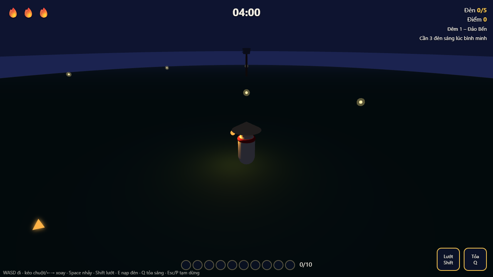

# Đảo Đèn Lồng — Day 12 AI SDLC (2A202603580 Đậu Phúc Đức)

> Video demo: xem Release v1.0.0 (hoặc `docs/demo/demo.mp4`).

Game 3D góc nhìn thứ ba (Three.js). Mây, người giữ đèn đội nón lá treo đèn lồng nhỏ, gom đom đóm để thắp và giữ sáng Đèn Lồng Lớn trên ba hòn đảo tới bình minh, tỏa sáng để xua Bóng Mực.



## Yêu cầu hệ thống
- Node.js ≥ 20 (Windows, macOS, Linux). Không cần cài thêm gì khác để chơi.
- Trình duyệt có WebGL2: Chrome, Edge, Firefox hoặc Safari bản mới.
- Benchmark cần Chrome, Chromium hoặc Edge (tự tìm; hoặc đặt biến `CHROME_PATH`).

## Cài và chơi (2 lệnh)
```
npm ci
node scripts/play.mjs        # build bản web, mở game ở http://127.0.0.1:8080/
```
`node scripts/play.mjs` là `run_cmd` trong `game.contract.json`. Nếu cổng 8080 bận (ví dụ Apache/XAMPP) hoặc bị Windows chặn, máy chủ tự thử 8081–8089 rồi một cổng trống bất kỳ; địa chỉ thật được in ra terminal. Thêm `--port N` để chọn cổng, `--no-open` để không tự mở trình duyệt. Khi phát triển có thể dùng `npm run dev` (Vite, tải lại nóng; bảng xếp hạng khi đó lưu trong trình duyệt).

Bản phát hành (không cần `npm ci`): tải `dao-den-long-v1.0.0-web.zip` ở Release v1.0.0, giải nén, chạy `node scripts/serve.mjs`.

## Điều khiển (đổi được trong Cài đặt → Phím)
| Phím mặc định | Việc |
|---|---|
| W A S D | đi theo hướng camera |
| Kéo chuột / ← → | xoay camera (độ nhạy chỉnh trong Cài đặt) |
| Space | nhảy |
| F | lướt (14 m/s trong 0.2 s, hồi 1.5 s; trên không chỉ lướt 1 lần tới khi chạm đất) |
| E | nạp đom đóm vào đèn gần nhất trong 2 m: thắp đèn tắt, hoặc châm dầu đèn đang sáng |
| Q | tỏa sáng: tốn 3 đom đóm, choáng Bóng Mực trong 5 m, hồi 3 s |
| Esc | tạm dừng (Tiếp tục / Chơi lại Đêm / Cài đặt / Về menu) |

Lướt mặc định là F, không phải Shift: trên Windows, bấm Shift 5 lần sẽ mở hộp thoại Sticky Keys và lấy mất focus. Game cũng tự tạm dừng và nhả mọi phím khi cửa sổ mất focus.

## Dễ tiếp cận (Cài đặt)
- **Đổi phím** cho cả 9 hành động. Phím trùng bị từ chối và báo tên hành động đang dùng phím đó. Có nút "Khôi phục mặc định". Lưu giữa các lần mở.
- **Phụ đề / chỉ báo hình**: "Bóng Mực xuất hiện" kèm mũi tên tím ở mép màn hình chỉ tới nó (4 s); "Gió sắp nổi"; đếm "N giây cuối" trong 10 s cuối; "Đèn Lx sắp cạn dầu" khi đèn tụt dưới 30; "Đèn Lx đã tắt". Mũi tên cam chỉ đèn cần chăm gần nhất khi nó ở ngoài màn hình.
- **Giảm chuyển động**: tắt mọi hiệu ứng nhấp nháy (đồng hồ, đèn yếu, Mây bất tử, Đom Đóm Chúa, Đuốc). Game không có rung camera. Tự bật nếu hệ điều hành đặt `prefers-reduced-motion`.
- **Cỡ chữ**: tối thiểu 18 px; tùy chọn "Chữ lớn" ×1.25 (22.5 px).
- **Bảng màu dễ phân biệt** (mù màu): viền Bóng Mực #00B3FF, cảnh báo trắng kèm ⚠.

## Luật và cách tính điểm (Ticket-03 "Đèn cạn dầu")
- Ba Đêm: Đảo Bến (5 đèn, 240 s), Đảo Cau (6 đèn, 270 s), Đảo Chuông (7 đèn, 300 s). **Mục tiêu: giữ đảo sáng tới bình minh.** Hết giờ mà còn ≥ 60% số đèn đang sáng (3/5, 4/6, 5/7) thì thắng. Thắp đủ đèn sớm không kết thúc Đêm. Thắng Đêm 3 thì tới Bình Minh. Thua thì chơi lại Đêm đó.
- Đèn chưa từng sáng cần 10 đom đóm, đèn đã từng sáng chỉ cần 5 để thắp lại. Đèn sáng có 100 dầu, hao 1 dầu/giây, hết dầu thì tắt. Bấm E ở đèn đang sáng để châm dầu: mỗi đom đóm thêm 10 dầu.
- Đèn sáng có dầu ≥ 30 tạo vùng an toàn 6 m. Đèn dưới 30 dầu thì nhấp nháy, mất vùng an toàn, và Bóng Mực sẽ tới hút 5 dầu/giây.
- Sức chứa đom đóm = 10 + 2 × số lần thắp thành công trong Đêm, tối đa 20.
- 3 Ngọn Lửa, hồi đầy đầu mỗi Đêm. Bóng Mực chạm thì −1 lửa, rơi một nửa đom đóm đang mang, bất tử 1.5 s. Rơi khỏi đảo thì −1 lửa và mất hết đom đóm.
- Gió Lạc (Đêm 2, 3) cướp tối đa 3 đom đóm khi Mây mang từ 5 trở lên. Bùa Gió tăng tốc lên 7.2 m/s và bỏ hồi chiêu Lướt trong 10 s.
- Điểm: +5 mỗi đom đóm nạp (thắp, thắp lại hoặc châm dầu), +100 khi thắp lần đầu, +40 khi thắp lại, +5 mỗi Bóng Mực trúng Tỏa Sáng (+15 nếu nó đang hút dầu). Khi thắng: mỗi đèn đang sáng +50 + floor(dầu), mỗi Ngọn Lửa +50. Tổng điểm là tổng các Đêm đã thắng.

## Bảng xếp hạng
- Thua ở bất kỳ Đêm nào, hoặc tới Bình Minh, thì nhập tên để lưu điểm. Tên 3–12 ký tự chữ, số hoặc `_`; chữ tiếng Việt có dấu được chấp nhận.
- Mỗi mục: `name`, `score` (tổng điểm các Đêm đã thắng), `nights_won`, `achieved_at` (ISO 8601 có múi giờ), `seed` (seed của lượt chơi; Đêm n dùng seed + n − 1). Giữ top 10, điểm giảm dần, bằng điểm thì ai đạt trước đứng trên.
- Lưu ở `leaderboard.json` cạnh mã nguồn (hoặc đường dẫn trong biến `DDL_LEADERBOARD`), còn sau khi tắt và mở lại. Xem từ menu chính → "Bảng xếp hạng".
- Xuất: `node scripts/play.mjs --export-leaderboard out.json` → `{"entries": [...]}` đúng thứ tự.

## Test, headless, bench, soak
```
npm test                                                     # toàn bộ test (luật, headless, sáng tạo, Phase 4)
node src/headless.js --seed 1 --night 1 --ticks 600 --out out.jsonl [--scenario s.json] [--inputs i.json] [--snapshot-every 10]
node scripts/bench.mjs --seed 42 --duration 30 --out bench.json
node --expose-gc --jitless --single-threaded --max-semi-space-size=1 src/soak.js --seed 7 --nights 10 --out soak.json
```
Các lệnh này nằm trong `game.contract.json` (v1.3): `headless_cmd`, `bench_cmd`, `soak_cmd`.

**Benchmark.** `scripts/bench.mjs` build bản web, mở máy chủ cục bộ, rồi mở Chrome/Edge với hồ sơ tạm (không đụng trình duyệt của bạn), cửa sổ 1280×720, `--force-device-scale-factor=1`. Cảnh bench luôn vẽ đúng 1280×720, tỉ lệ điểm ảnh 1. Tắt vsync bằng `--disable-gpu-vsync --disable-frame-rate-limit`. Cảnh chuẩn: Đêm 1 đủ hiệu ứng, 200 Bóng Mực wander và 100 đom đóm rải đều theo seed, L1–L3 sáng 100 dầu; tắt sinh thêm, sát thương, nhặt, hao dầu, kết thúc Đêm; Mây đứng ở (0,0,0); camera bay vòng bán kính 30 m, cao 15 m, 15 s một vòng, ngược chiều kim đồng hồ nhìn từ trên. Khởi động 3 s, đo đúng `--duration` giây, ghi file, đóng trình duyệt, thoát mã 0. Tính năng sáng tạo tắt trong cảnh này.
- `load_ms`: từ lúc mở tiến trình trình duyệt tới khung hình đầu tiên của cảnh bench (thời gian build trước đó không tính).
- `peak_mem_mb`: `null`. Đây là bản web, game chạy trong nhiều tiến trình của trình duyệt (browser, GPU, renderer). Trang web không đọc được RSS của các tiến trình đó, và không có cách đo thống nhất trên cả ba hệ điều hành.
- Kết quả của tôi (`bench.json`, Intel Iris Plus, i7-1065G7, Windows 11): avg 158.1 FPS, p1 low 76.9 FPS, p95 8.6 ms, load 1193 ms.

**Soak.** Chạy 10 Đêm liên tiếp (1 → 2 → 3 xoay vòng) trong một tiến trình, Đêm thứ i (đếm từ 0) dùng seed 7 + i, input ngẫu nhiên theo seed đúng tỉ lệ của đề. Cờ Node: `--expose-gc` để dọn rác trước khi đo RSS; `--jitless --single-threaded --max-semi-space-size=1` để RSS không phình vì bộ nhớ native của trình biên dịch V8, luồng nền và vùng nhớ trẻ (không có `--jitless`, CI ubuntu đo ×1.27). Tôi đã kiểm tra: không có rò rỉ, heap JS đang dùng giữ ở 4.2–4.6 MB qua 10 Đêm. Kết quả của tôi (`soak.json`, Windows): 0 crash, RSS 44.4 → 45.9 MB (×1.03), khoảng 3 s.

## Sáng tạo của tôi
Chỉ bật trong bản web (`createGame({ creative: true })`). Headless, bench và soak không bật, nên đầu ra headless không đổi (đã so byte với bản trước). Sáng tạo dùng RNG riêng, nên bật lên cũng không làm đổi chuỗi ngẫu nhiên của game gốc. Test: `tests/sang-tao.test.js`.
- **Đom Đóm Chúa**: xuất hiện lần đầu lúc 15 s, sau đó mỗi 30 s, tối đa 1 con, tự bay mất sau 20 s (nhấp nháy 3 s cuối). Nhặt được +5 đom đóm (tới sức chứa) và +25 điểm ngay. Đầy sức chứa thì không nhặt được.
- **Đuốc**: cắm trên đảo lần đầu lúc 30 s, sau đó mỗi 45 s, tối đa 1 cây. Nhặt thì Mây cầm đuốc 30 s. Đuốc tự Tỏa Sáng như phím Q lúc nhặt và mỗi 3 s: choáng, đẩy Bóng Mực và tính điểm như Q, nhưng không tốn đom đóm và không đụng hồi chiêu Q.

## Tuning
Mọi số trong `game.contract.json` khớp số chuẩn Ticket-02/03. `per_second_left: 0` vì Ticket-03 bỏ thưởng thời gian. Logic đọc trực tiếp từ file này. Hằng số chuẩn không có khóa tuning (nhảy 7 m/s, trọng lực 20, lịch sinh…) nằm ở đầu `src/sim/game.js`.

## Kiểm chứng, tài liệu và harness
- Ghi chú, giả định, acceptance criteria, bảng truy vết: `docs/notes/phase-N.md`. Bằng chứng: `docs/proof/`. Retro: `docs/retro.md`. Nhật ký AI: `docs/notes/ai-log.md`.
- `npm run verify -- phase-N`: chạy test, headless 3 Đêm hai lần để so tất định, đo thời gian, ghi `docs/proof/phase-N/verify.md`.
- CI (`.github/workflows/ci.yml`): test, headless tất định, soak, xuất bảng xếp hạng và build trên ubuntu + macOS mỗi lần push.
- Harness AI: `AGENTS.md` (`CLAUDE.md` trỏ tới nó); Stop hook `.claude/hooks/stop-tests.mjs` chặn agent kết thúc khi `npm test` đỏ; skill `.claude/skills/verify` để chạy kiểm chứng và lưu bằng chứng trước khi gắn tag.
- `CHANGELOG.md`, `CREDITS.md`, `LICENSE` (MIT).
